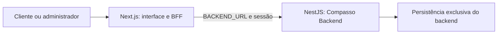

# Frontend e BFF

O navegador acessa somente `/api`. Os Route Handlers formam a fronteira do BFF: controlam o cookie de sessão, validam origem e rotas e não retornam o token ao JavaScript do cliente.

O backend controla autorização por loja e papel, disponibilidade, cálculos e mudanças de estado. O frontend mantém apenas o estado da experiência e da sacola; o checkout revalida preço e agenda na API. Não há imports nem dependências do repositório backend.

As áreas funcionais ficam em `src/modules`. Os componentes compartilhados não conhecem detalhes da persistência. Telas secundárias usam carregamento sob demanda, enquanto o BFF agrega em paralelo as leituras iniciais necessárias ao painel.
